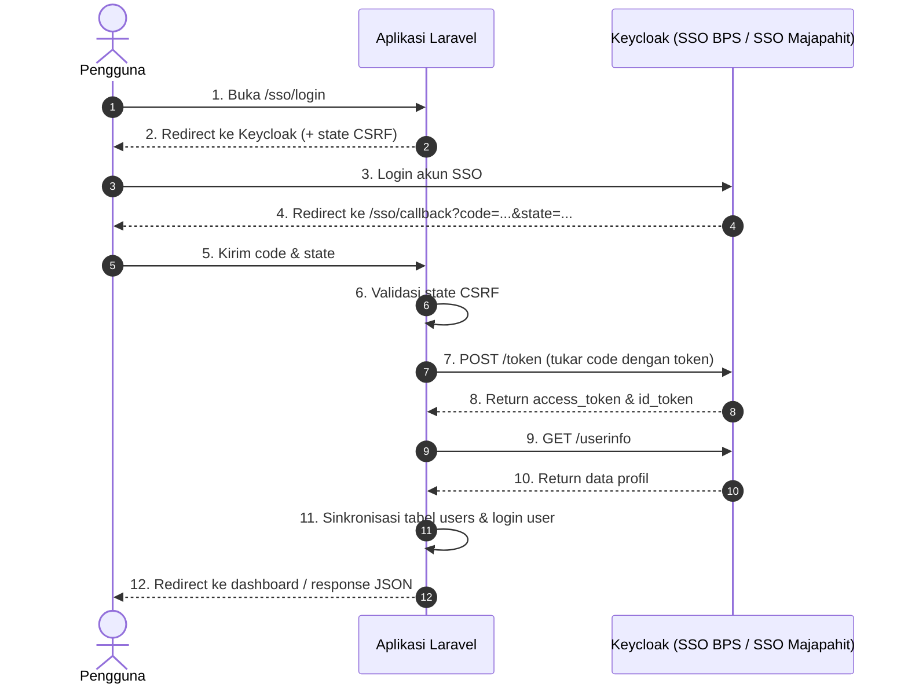

# BPS Auth for Laravel

<p align="center">
  
</p>

<p align="center">
  Package autentikasi Keycloak Single Sign-On (SSO BPS & SSO Majapahit) dan REST API Pegawai untuk Laravel.
</p>

<p align="center">
  <strong>Bahasa Indonesia</strong> | <a href="README.md">English</a>
</p>

<p align="center">
  <a href="https://packagist.org/packages/putuwahyu29/bps-auth"></a>
  <a href="https://github.com/putuwahyu29/bps-auth/actions"></a>
  <a href="https://packagist.org/packages/putuwahyu29/bps-auth"></a>
  <a href="https://php.net"></a>
  <a href="https://laravel.com"></a>
  <a href="LICENSE"></a>
</p>

---

## Fitur

- **Multi-Driver**: Mendukung koneksi **SSO BPS** (`accounts.bps.go.id`) dan **SSO Majapahit** dalam satu package.
- **Ekstraksi Atribut**: Ekstraksi NIP Lama (9 digit), NIP Baru (18 digit), kode satker wilayah dari grup Majapahit atau klaim provinsi/kabupaten, dan roles Keycloak.
- **Dukungan Multi-Arsitektur**: Mendukung Laravel Blade/Livewire, Inertia.js, serta REST API (Sanctum/Mobile).
- **REST API Data Pegawai**: Query data pegawai dengan Client Credentials (token di-cache otomatis 50 menit).
- **Keamanan**: Validasi CSRF state token, Single Logout (RP-Initiated), dan whitelist domain email.

---

## Alur Autentikasi



---

## Persyaratan Sistem

- PHP `^8.1 || ^8.2 || ^8.3 || ^8.4`
- Laravel `^9.0 || ^10.0 || ^11.0 || ^12.0 || ^13.0`
- Ekstensi PHP: `cURL`, `OpenSSL`, `JSON`, `Mbstring`

---

## Instalasi

```bash
composer require putuwahyu29/bps-auth
```

Publikasikan file konfigurasi:
```bash
php artisan vendor:publish --tag=sso-bps-config
```
File konfigurasi akan tersimpan di `config/sso-bps.php`.

---

## Konfigurasi Environment (`.env`)

### Opsi A: SSO BPS (Default)
```env
BPS_SSO_DRIVER=pusat

BPS_SSO_KEYCLOAK_URL=https://accounts.bps.go.id
BPS_SSO_REALM=pegawai
BPS_SSO_CLIENT_ID=client-id-anda
BPS_SSO_CLIENT_SECRET=client-secret-anda
BPS_SSO_REDIRECT_AFTER_LOGIN=/dashboard
```

### Opsi B: SSO Majapahit
```env
BPS_SSO_DRIVER=majapahit

MAJAPAHIT_SSO_URL=https://sso-majapahit.bps.go.id
MAJAPAHIT_SSO_REALM=master
MAJAPAHIT_SSO_CLIENT_ID=client-id-anda
MAJAPAHIT_SSO_CLIENT_SECRET=client-secret-anda
BPS_SSO_REDIRECT_AFTER_LOGIN=/dashboard
```

### Whitelist Domain Email (Opsional)
```env
BPS_SSO_ALLOWED_EMAIL_DOMAINS=bps.go.id
```

## Penggunaan

Package ini menyediakan dua opsi integrasi:
1. **Mode Bawaan (Plug & Play)**: Cukup pasang tombol login dan proteksi rute. Rute `/sso/login`, `/sso/callback`, dan `/sso/logout` sudah aktif otomatis tanpa perlu menulis Controller tambahan. Pengguna otomatis dibuat/disinkronkan ke tabel `users` dan login ke sesi Laravel.
2. **Mode Kustom**: Untuk arsitektur headless (Inertia, REST API Sanctum/JWT, atau skema tabel kustom), gunakan Facade `BpsSso` dan daftarkan resolver sesuai kebutuhan aplikasi Anda.

---

### Rute Bawaan (Built-in Routes)

Package secara otomatis mendaftarkan rute berikut:

| Method | URL | Deskripsi |
|---|---|---|
| `GET` | `/sso/login` | Redirect ke halaman login Keycloak (driver default). |
| `GET` | `/sso/callback` | Menerima callback dari Keycloak, menukar token, membuat/update user, dan login sesi. |
| `GET` | `/sso/logout` | Logout dari sesi Laravel dan redirect ke Single Logout Keycloak. |
| `GET` | `/sso/{driver}/login` | Redirect ke Keycloak untuk driver tertentu (contoh: `/sso/majapahit/login`). |
| `GET` | `/sso/{driver}/callback` | Endpoint callback untuk driver tertentu. |

Prefix rute `/sso` dapat disesuaikan di file `.env`:
```env
BPS_SSO_ROUTE_PREFIX=auth/sso # Menghasilkan /auth/sso/login, dll.
```

---

### 1. Mode Bawaan (Blade / Livewire)

Jika aplikasi Anda sudah memiliki halaman login (misalnya di `resources/views/auth/login.blade.php`), Anda tidak perlu mengganti form yang ada. Cukup sisipkan tombol login SSO di halaman tersebut:

```blade
<!-- Form login lokal yang sudah ada -->
<form method="POST" action="{{ route('login') }}">
    @csrf
    <!-- Input email & password... -->
    <button type="submit">Masuk</button>
</form>

<div class="divider">atau</div>

<!-- Tombol SSO BPS (Default) -->
<x-bps-sso-button text="Masuk dengan SSO BPS" />

<!-- Tombol SSO Majapahit (Opsional) -->
<x-bps-sso-button driver="majapahit" text="Masuk dengan SSO Majapahit" />
```

Setelah tombol diklik, package akan menangani seluruh proses secara otomatis:
1. Menghasilkan token CSRF state dan mengarahkan pengguna ke Keycloak.
2. Menerima callback dan menukar authorization code dengan access token & ID token.
3. Mengambil profil user dan mencocokkan/membuat data di tabel `users`.
4. Menjalankan `Auth::login($user)`.
5. Mengarahkan pengguna ke halaman tujuan (`BPS_SSO_REDIRECT_AFTER_LOGIN` atau URL sebelumnya).

Proteksi rute menggunakan middleware:
```php
Route::middleware(['bps.sso'])->group(function () {
    Route::get('/dashboard', [DashboardController::class, 'index'])->name('dashboard');
});
```

Logout (Single Logout OIDC):
```blade
<a href="{{ route('bps-sso.logout') }}">Keluar</a>
```

---

### 2. Inertia.js (Vue & React)

Gunakan tag `<a>` standar (bukan komponen `<Link>` Inertia) untuk redirect ke Keycloak:

```vue
<template>
  <div class="auth-buttons">
    <a href="/sso/login" class="btn btn-primary">
      Masuk dengan SSO BPS
    </a>
    <a href="/sso/majapahit/login" class="btn btn-secondary">
      Masuk dengan SSO Majapahit
    </a>
  </div>
</template>
```

---

### 3. REST API / SPA / Mobile

Endpoint bawaan `/sso/login`, `/sso/callback`, dan `/sso/logout` otomatis mengembalikan response JSON jika request menyertakan header `Accept: application/json`.

Request URL login:
```http
GET /sso/login
Accept: application/json
```
Response:
```json
{
  "login_url": "https://accounts.bps.go.id/realms/pegawai/protocol/openid-connect/auth?...",
  "driver": "pusat"
}
```

Penerbitan token Sanctum pada controller kustom:
```php
namespace App\Http\Controllers\Api;

use Bps\Sso\Facades\BpsSso;
use Illuminate\Http\Request;

class AuthApiController
{
    public function callback(Request $request)
    {
        $result = BpsSso::handleCallback($request);
        $user = $result['user'];

        $apiToken = $user->createToken('auth-token')->plainTextToken;

        return response()->json([
            'token' => $apiToken,
            'user' => $user,
        ]);
    }
}
```

Verifikasi Bearer Token dari header:
```php
use Bps\Sso\Facades\BpsSso;

$user = BpsSso::userFromBearerToken();
```

---

## Ekstraksi Atribut BPS

Package menyediakan fungsi pembantu untuk membaca klaim Keycloak:

```php
use Bps\Sso\Facades\BpsSso;

$userInfo = BpsSso::getUserInfo();

// 1. Ekstrak NIP
$nipLama = BpsSso::extractNipLama($userInfo); // 9 digit (misal: '340012345')
$nipBaru = BpsSso::extractNipBaru($userInfo); // 18 digit (misal: '199001012015011001')
$nip     = BpsSso::extractNip($userInfo, preferLama: true);

// 2. Ekstrak Kode Satker (4 digit)
// Mendukung format /Majapahit-3514, gabungan kodeprovinsi+kodekabupaten, atau 5 digit normalisasi
$kodeSatker = BpsSso::extractKodeSatker($userInfo);

// 3. Ekstrak Roles Keycloak
$roles = BpsSso::extractRoles($userInfo);
```

---

## REST API Data Pegawai

Query data pegawai menggunakan Client Credentials Grant:

```php
use Bps\Sso\Facades\BpsSso;

// Query berdasarkan email, NIP, atau username
$pegawai = BpsSso::pegawai()->findByEmail('pegawai@bps.go.id');
$pegawai = BpsSso::pegawai()->findByNipBaru('199001012015012001');
$pegawai = BpsSso::pegawai()->findByNip('340056734');
$pegawai = BpsSso::pegawai()->findByUsername('budi.santoso');

if ($pegawai) {
    echo $pegawai->getName();
    echo $pegawai->getNipBaru();
    echo $pegawai->getNip();
    echo $pegawai->getEmail();
    echo $pegawai->getJabatan();
    echo $pegawai->getUnit();
    echo $pegawai->getUsername();
}

// Query seluruh pegawai dalam satu satker
$list = BpsSso::pegawai()->findByUnit('34000');
```

---

## Kustomisasi User Resolver

Jika struktur tabel `users` membutuhkan penyesuaian khusus (misal kolom NIP lama atau kode satker), daftarkan resolver di `app/Providers/AppServiceProvider.php`:

```php
use Bps\Sso\Facades\BpsSso;
use App\Models\User;

public function boot(): void
{
    BpsSso::resolveUserUsing(function (array $userInfo, array $tokens, string $driver) {
        $email = $userInfo['email'] ?? null;
        $nip = BpsSso::extractNipLama($userInfo);
        $kodeSatker = BpsSso::extractKodeSatker($userInfo);

        if ((!$nip || !$kodeSatker) && $email) {
            try {
                $pegawai = BpsSso::pegawai()->findByEmail($email);
                if ($pegawai) {
                    $nip = $nip ?: $pegawai->getNip();
                    $kodeSatker = $kodeSatker ?: substr($pegawai->getUnit() ?? '', 0, 4);
                }
            } catch (\Throwable $e) {
                // Lewati jika service account tidak aktif
            }
        }

        return User::updateOrCreate(
            ['email' => $email],
            [
                'name' => $userInfo['name'] ?? 'Pegawai BPS',
                'nip' => $nip,
                'kode_satker' => $kodeSatker,
            ]
        );
    });
}
```

---

## Event

Daftarkan listener pada event autentikasi:

```php
use Bps\Sso\Events\BpsSsoAuthenticated;
use Illuminate\Support\Facades\Event;

Event::listen(BpsSsoAuthenticated::class, function (BpsSsoAuthenticated $event) {
    $user = $event->user;
    // Logika setelah user terautentikasi (misal sinkronisasi role/permission)
});
```

---

## Pengujian

```bash
composer test
```

---

## Kontribusi

Silakan baca [CONTRIBUTING.md](CONTRIBUTING.md).

---

## Lisensi

Paket ini dirilis di bawah [MIT License](LICENSE).  
Copyright © 2026 Putu Wahyu.
