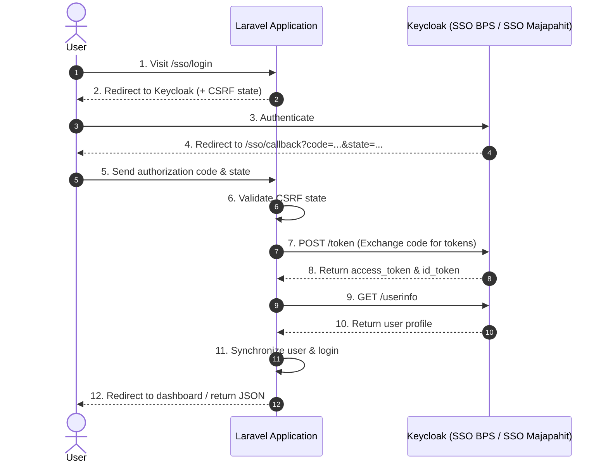

# BPS Auth for Laravel

<p align="center">
  
</p>

<p align="center">
  Keycloak Single Sign-On (SSO BPS & SSO Majapahit) and Employee REST API package for Laravel.
</p>

<p align="center">
  <a href="README.id.md">Bahasa Indonesia</a> | <strong>English</strong>
</p>

<p align="center">
  <a href="https://packagist.org/packages/putuwahyu29/bps-auth"></a>
  <a href="https://github.com/putuwahyu29/bps-auth/actions"></a>
  <a href="https://packagist.org/packages/putuwahyu29/bps-auth"></a>
  <a href="https://php.net"></a>
  <a href="https://laravel.com"></a>
  <a href="LICENSE"></a>
</p>

---

## Features

- **Multi-Driver**: Supports **SSO BPS** (`accounts.bps.go.id`) and **SSO Majapahit** connections.
- **Attribute Extraction**: Helpers for 9-digit legacy NIP, 18-digit modern NIP, agency/regional code (satker), and Keycloak roles.
- **Architecture Support**: Full Stack (Blade/Livewire), Inertia.js, and Headless REST API (Sanctum/Mobile).
- **Employee REST API**: Server-to-server queries via Client Credentials Grant with automated token caching (50-minute TTL).
- **Security**: Timing-attack safe CSRF state validation, OIDC RP-Initiated Single Logout, and email domain whitelist.

---

## Authentication Flow



---

## System Requirements

- PHP `^8.1 || ^8.2 || ^8.3 || ^8.4`
- Laravel `^9.0 || ^10.0 || ^11.0 || ^12.0 || ^13.0`
- PHP Extensions: `cURL`, `OpenSSL`, `JSON`, `Mbstring`

---

## Installation

```bash
composer require putuwahyu29/bps-auth
```

Publish configuration:
```bash
php artisan vendor:publish --tag=sso-bps-config
```
Configuration file will be placed at `config/sso-bps.php`.

---

## Environment Configuration (`.env`)

### Option A: SSO BPS (Default)
```env
BPS_SSO_DRIVER=pusat

BPS_SSO_KEYCLOAK_URL=https://accounts.bps.go.id
BPS_SSO_REALM=pegawai
BPS_SSO_CLIENT_ID=your-client-id
BPS_SSO_CLIENT_SECRET=your-client-secret
BPS_SSO_REDIRECT_AFTER_LOGIN=/dashboard
```

### Option B: SSO Majapahit
```env
BPS_SSO_DRIVER=majapahit

MAJAPAHIT_SSO_URL=https://sso-majapahit.bps.go.id
MAJAPAHIT_SSO_REALM=master
MAJAPAHIT_SSO_CLIENT_ID=your-client-id
MAJAPAHIT_SSO_CLIENT_SECRET=your-client-secret
BPS_SSO_REDIRECT_AFTER_LOGIN=/dashboard
```

### Email Domain Whitelist (Optional)
```env
BPS_SSO_ALLOWED_EMAIL_DOMAINS=bps.go.id
```

## Usage

This package provides two integration approaches:
1. **Default Mode (Plug & Play)**: Simply add the login button to your existing login view and protect your routes with middleware. Built-in routes `/sso/login`, `/sso/callback`, and `/sso/logout` are enabled automatically without writing custom controllers. Authenticated users are synchronized into your `users` table and signed in via standard Laravel session.
2. **Custom Mode**: For headless/decoupled architectures (Inertia, REST API Sanctum/JWT, or custom user database schemas), use the `BpsSso` facade and register a custom user resolver.

---

### Built-in Routes

The package automatically registers the following routes:

| Method | URL | Description |
|---|---|---|
| `GET` | `/sso/login` | Redirect to Keycloak login page (default driver). |
| `GET` | `/sso/callback` | Handle Keycloak callback, exchange tokens, create/update user, and log in. |
| `GET` | `/sso/logout` | Log out from Laravel session and redirect to Keycloak Single Logout. |
| `GET` | `/sso/{driver}/login` | Redirect to Keycloak for a specific driver (e.g. `/sso/majapahit/login`). |
| `GET` | `/sso/{driver}/callback` | Callback endpoint for a specific driver. |

The `/sso` route prefix can be customized in your `.env` file:
```env
BPS_SSO_ROUTE_PREFIX=auth/sso # Generates /auth/sso/login, etc.
```

---

### 1. Default Mode (Blade / Livewire)

If your application already has an existing login view (e.g., `resources/views/auth/login.blade.php`), you don't need to rebuild or replace it. Simply insert the SSO login button into your template:

```blade
<!-- Existing email/password login form -->
<form method="POST" action="{{ route('login') }}">
    @csrf
    <!-- Input email & password... -->
    <button type="submit">Sign In</button>
</form>

<div class="divider">or</div>

<!-- SSO BPS Button (Default) -->
<x-bps-sso-button text="Sign in with SSO BPS" />

<!-- SSO Majapahit Button (Optional) -->
<x-bps-sso-button driver="majapahit" text="Sign in with SSO Majapahit" />
```

Once clicked, the package handles the entire authentication lifecycle:
1. Generates a timing-safe CSRF state token and redirects to Keycloak.
2. Receives the authorization code at `/sso/callback` and exchanges it for tokens.
3. Automatically queries user claims and syncs the record in the `users` table.
4. Executes `Auth::login($user)`.
5. Redirects to your target destination (`BPS_SSO_REDIRECT_AFTER_LOGIN` or intended URL).

Protect routes using middleware:
```php
Route::middleware(['bps.sso'])->group(function () {
    Route::get('/dashboard', [DashboardController::class, 'index'])->name('dashboard');
});
```

Logout (OIDC Single Logout):
```blade
<a href="{{ route('bps-sso.logout') }}">Log Out</a>
```

---

### 2. Inertia.js (Vue & React)

Use standard `<a>` tags instead of Inertia `<Link>` components for redirecting to Keycloak:

```vue
<template>
  <div class="auth-buttons">
    <a href="/sso/login" class="btn btn-primary">
      Sign in with SSO BPS
    </a>
    <a href="/sso/majapahit/login" class="btn btn-secondary">
      Sign in with SSO Majapahit
    </a>
  </div>
</template>
```

---

### 3. REST API / SPA / Mobile

Built-in endpoints `/sso/login`, `/sso/callback`, and `/sso/logout` return JSON when the request has an `Accept: application/json` header.

Get login URL:
```http
GET /sso/login
Accept: application/json
```
Response:
```json
{
  "login_url": "https://accounts.bps.go.id/realms/pegawai/protocol/openid-connect/auth?...",
  "driver": "pusat"
}
```

Issuing Sanctum tokens in a custom controller:
```php
namespace App\Http\Controllers\Api;

use Bps\Sso\Facades\BpsSso;
use Illuminate\Http\Request;

class AuthApiController
{
    public function callback(Request $request)
    {
        $result = BpsSso::handleCallback($request);
        $user = $result['user'];

        $apiToken = $user->createToken('auth-token')->plainTextToken;

        return response()->json([
            'token' => $apiToken,
            'user' => $user,
        ]);
    }
}
```

Verify Bearer Token directly from header:
```php
use Bps\Sso\Facades\BpsSso;

$user = BpsSso::userFromBearerToken();
```

---

## Attribute Extraction

```php
use Bps\Sso\Facades\BpsSso;

$userInfo = BpsSso::getUserInfo();

// 1. Extract NIP
$nipLama = BpsSso::extractNipLama($userInfo); // 9 digits (e.g. '340012345')
$nipBaru = BpsSso::extractNipBaru($userInfo); // 18 digits (e.g. '199001012015011001')
$nip     = BpsSso::extractNip($userInfo, preferLama: true);

// 2. Extract Agency / Region Code (4 digits)
// Handles /Majapahit-3514, kodeprovinsi+kodekabupaten, or 5-digit normalization
$kodeSatker = BpsSso::extractKodeSatker($userInfo);

// 3. Extract Roles
$roles = BpsSso::extractRoles($userInfo);
```

---

## Employee REST API

Query employee records via Client Credentials:

```php
use Bps\Sso\Facades\BpsSso;

$pegawai = BpsSso::pegawai()->findByEmail('pegawai@bps.go.id');
$pegawai = BpsSso::pegawai()->findByNipBaru('199001012015012001');
$pegawai = BpsSso::pegawai()->findByNip('340056734');
$pegawai = BpsSso::pegawai()->findByUsername('budi.santoso');

if ($pegawai) {
    echo $pegawai->getName();
    echo $pegawai->getNipBaru();
    echo $pegawai->getNip();
    echo $pegawai->getEmail();
    echo $pegawai->getJabatan();
    echo $pegawai->getUnit();
    echo $pegawai->getUsername();
}

// Find all employees in an agency unit
$employees = BpsSso::pegawai()->findByUnit('34000');
```

---

## Custom User Resolver

If your user schema requires custom mapping (e.g., legacy 9-digit NIP or custom satker column), register a resolver in `app/Providers/AppServiceProvider.php`:

```php
use Bps\Sso\Facades\BpsSso;
use App\Models\User;

public function boot(): void
{
    BpsSso::resolveUserUsing(function (array $userInfo, array $tokens, string $driver) {
        $email = $userInfo['email'] ?? null;
        $nip = BpsSso::extractNipLama($userInfo);
        $kodeSatker = BpsSso::extractKodeSatker($userInfo);

        if ((!$nip || !$kodeSatker) && $email) {
            try {
                $pegawai = BpsSso::pegawai()->findByEmail($email);
                if ($pegawai) {
                    $nip = $nip ?: $pegawai->getNip();
                    $kodeSatker = $kodeSatker ?: substr($pegawai->getUnit() ?? '', 0, 4);
                }
            } catch (\Throwable $e) {
                // Ignore if service account is not enabled
            }
        }

        return User::updateOrCreate(
            ['email' => $email],
            [
                'name' => $userInfo['name'] ?? 'BPS User',
                'nip' => $nip,
                'kode_satker' => $kodeSatker,
            ]
        );
    });
}
```

---

## Events

```php
use Bps\Sso\Events\BpsSsoAuthenticated;
use Illuminate\Support\Facades\Event;

Event::listen(BpsSsoAuthenticated::class, function (BpsSsoAuthenticated $event) {
    $user = $event->user;
    // Perform post-authentication actions (e.g., sync roles/permissions)
});
```

---

## Testing

```bash
composer test
```

---

## Contributing

Please see [CONTRIBUTING.md](CONTRIBUTING.md).

---

## License

The MIT License (MIT). Please see [License File](LICENSE) for more information.  
Copyright © 2026 Putu Wahyu.
